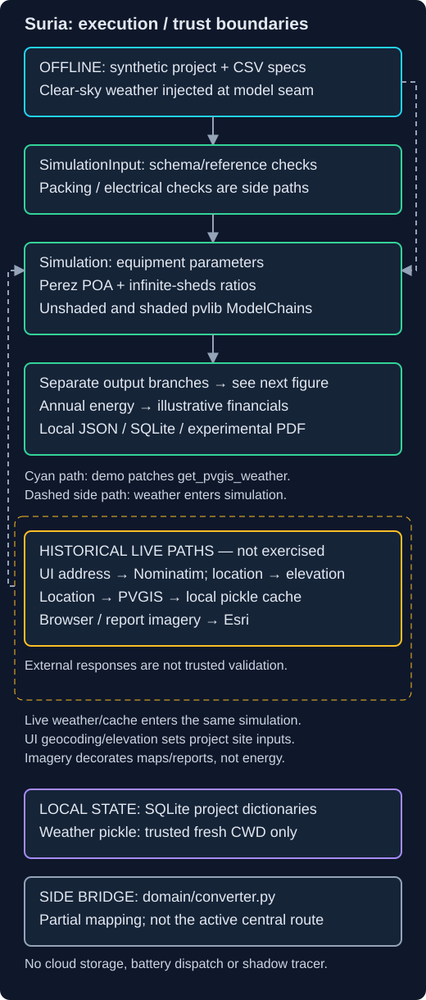
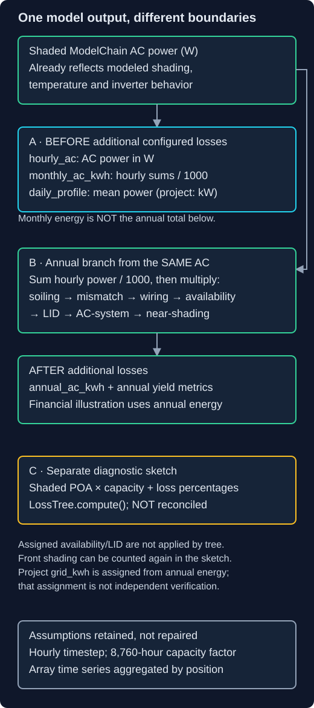

# Suria — archived solar-PV integration experiment

Suria connects a three-step Streamlit workflow with approximate polygon packing, pvlib-based energy modeling, string/inverter checks, SQLite project storage and PDF reporting. The useful engineering work is the integration: a project moves from component selection and geometry into schema/reference checks, numerical modeling and several output formats.

**Archived and unsupported.** This snapshot retains known numerical inconsistencies and incomplete UI paths. Solar product development is stopped. It is not a validated yield, installation-design, regulatory-eligibility or investment tool; no measured accuracy or equivalence to a commercial design package is claimed.

## Start with the offline example

The demo generates a mathematical clear-sky year, injects it at the weather-provider boundary, and runs the actual simulation functions. It also exercises local persistence, reporting and polygon packing. No live weather, map, geocoding or browser session is needed.

Use **CPython 3.12** with the dependency versions recorded in `uv.lock`. A fresh local virtual environment was installed **offline from an existing dependency cache** and the affected checks were exercised. This is not a clean-machine or online-download test. See [setup evidence and reproduction limits](docs/VERIFICATION.md). The locked setup is `uv sync --locked` with Python 3.12; dependency acquisition on a machine without that cache remains untested.

```bash
# In an environment already containing the locked dependencies:
# Start in the source root; demo-output must not exist.
python -B tools/offline_demo.py --output demo-output

# Tests may create local DB/cache files: use a fresh disposable CWD.
# Replace SOURCE with the absolute path to this source tree.
mkdir test-work
cd test-work
python -B SOURCE/tools/offline_pytest.py
```

The demo creates synthetic weather, project/result JSON, a summary, a disposable SQLite DB and an experimental PDF. These are local outputs, not public showcase assets. The summary includes the local source path; review outputs before sharing. PDF generation is an artifact smoke check, **not visual acceptance**. No PDF is distributed in this snapshot.

## Execution and trust boundaries



The fixture replaces only `get_pvgis_weather`; it does not replace ModelChain with expected results. In the historical UI, address text and coordinates can leave the process through geocoding, elevation, imagery and weather requests. SQLite and the weather cache are local state, not cloud services. **Never consume an untrusted pickle cache**; work in a new trusted directory.

| Area | What is implemented | Boundary |
| --- | --- | --- |
| Input | Pydantic component-reference checks | Not comprehensive physical validation |
| Geometry | Local projection, rotated center-based packing, setbacks and keepouts | Not full corner containment or obstacle shadow tracing |
| Simulation | Perez transposition, infinite-sheds ratios, two pvlib ModelChains, configured losses | Synthetic exercise, not physical validation |
| Electrical | Illustrative string voltage/current and loading checks | No automatic MPPT wiring or certified electrical design |
| Persistence/reporting | Parameterized SQLite, JSON state, fpdf2 and matplotlib output | Single-user state; PDF and UI scenarios can diverge |
| Domain model | Separate typed hierarchy and converter | Partial side bridge, not the active lossless pipeline |

## Why the output branches differ



`annual_ac_kwh` includes sequential additional losses. `monthly_ac_kwh`, `hourly_ac` and the mean daily power profile are taken **before** those losses. They must not be summed or compared as equivalent representations of one yield. With the exercised synthetic fixture, annual after-loss energy is **12,789.3163 kWh**, while the before-loss monthly sum is **14,217.9953 kWh**. These are observed implementation outputs, not predictions for a real site.

The diagnostic loss tree is another reporting calculation, not an energy reconciliation. Its project `grid_kwh` is assigned from annual output; that equality does not independently validate the tree. [Detailed limitations](docs/LIMITATIONS.md) explain the omitted fields, time-index assumptions, geometry defects and stale financial-export path.

## Reading the code

- [`simulate.py`](src/suria/simulate.py): provider boundary, parameter construction, irradiance, two ModelChains and output aggregation.
- [`layout.py`](src/suria/layout.py) and [`electrical.py`](src/suria/electrical.py): approximate packing and coded configuration issues.
- [`simulation_input.py`](src/suria/domain/simulation_input.py) and [`storage.py`](src/suria/storage.py): reference checks and local persistence.
- [`reporter/render.py`](src/suria/reporter/render.py): charts/tables; professional layout must not be mistaken for validated numbers.
- [Engineering lessons](docs/ENGINEERING-LESSONS.md): concrete lessons from the retained boundaries, without a roadmap or repair promise.

## Verification, not certification

The prior unchanged baseline recorded 75 passing tests and 8 external-provider skips. This presentation edition reruns affected surfaces and a frozen/extracted offline demo; it does not claim a fresh full-suite qualification. [Verification](docs/VERIFICATION.md) distinguishes behavioral checks, artifact smoke checks and known-defect characterization. A passing assertion that monthly energy exceeds annual energy documents a defect; it is not numerical correctness.

The [historical interactive interface](docs/HISTORICAL-UI.md) is retained as unsupported source, not the recommended demo. Its inactive controls and external providers are not rehabilitated here. There is no hosted service or promise to update tariffs, providers or dependencies.

## Origin and reuse

This is an archival presentation edition of the existing Suria Python application. The modeling, geometry, financial, provider and converter implementations are preserved; only selected UI/report labels and project-installation metadata are adjusted.

No new license grant is made. Third-party libraries retain their respective licenses. The bundled component specifications are historical, unaudited inputs rather than verified manufacturer data or endorsements. No third-party images, customer projects, existing DB/cache or historical Git history are included.
